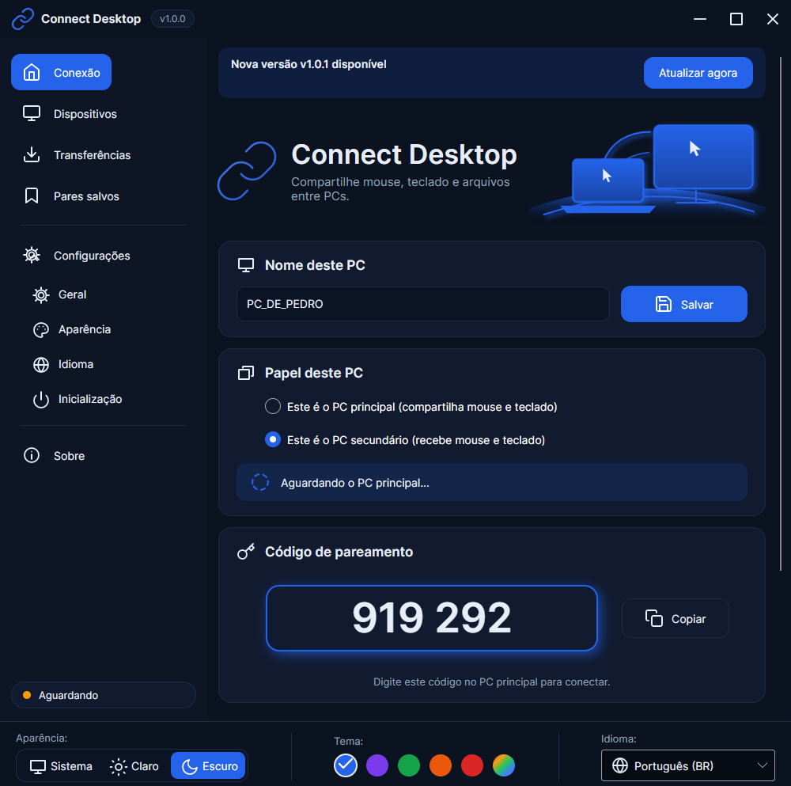

# Connect Desktop

Compartilhe o mouse e o teclado entre dois computadores na mesma rede. Encoste o mouse na borda da tela e ele passa para o outro PC, como se fossem um só.

Feito em .NET 8 com Avalonia. Funciona no Windows, macOS e Linux (sessão Xorg).



## Recursos

- Mouse e teclado do PC principal controlando o secundário, pela borda da tela (esquerda, direita, acima ou abaixo).
- Área de transferência compartilhada (texto).
- **Transferência de arquivos** nos dois sentidos: arraste para a janela ou use "Enviar arquivos…". Eles chegam em `Downloads/Connect Desktop`, com verificação de integridade (SHA-256).
- **Arrastar para o outro PC** (Windows): arraste arquivos, pastas, links ou texto até a borda do lado do outro PC e solte na faixa que aparece. Arquivos chegam em `Downloads/Connect Desktop` e o Explorer abre com eles selecionados; links abrem no navegador do outro PC; texto vai para a área de transferência dele.
- Conexão cifrada (ECDH + AES-GCM) e pareamento por código de 6 dígitos.
- Interface em **português, inglês e espanhol**, tema claro/escuro e cor de destaque.
- Abrir com o sistema (opcionalmente minimizado na bandeja) e atualização automática pelo GitHub Releases.

## Como instalar

Baixe o arquivo da versão mais recente na página de [Releases](https://github.com/SnowZ5303/connect-desktop/releases/latest):

- **Windows (x64):** `ConnectDesktop-Setup-win-x64.exe`. Execute e siga o assistente. Ele pede permissão de administrador, cria o atalho no menu Iniciar e configura a regra de firewall.
- **macOS:** `ConnectDesktop-mac-arm64.zip` (Apple Silicon) ou `ConnectDesktop-mac-x64.zip` (Intel). Descompacte e mova o **Connect Desktop.app** para a pasta Aplicativos.
- **Linux (x64):** `ConnectDesktop-linux-x64.tar.gz`. Extraia e execute `./ConnectDesktop` dentro da pasta `connect-desktop`. O arquivo `connect-desktop.desktop` incluso pode ser copiado para `~/.local/share/applications` depois de ajustar o campo `Exec` com o caminho completo do binário.

Instale o app nos dois computadores.

## Como usar

1. Abra o Connect Desktop nos dois PCs.
2. No PC que tem o mouse e o teclado que você quer usar, escolha **principal**. No outro, escolha **secundário**.
3. Um dos PCs mostra um código de 6 dígitos. Digite esse código no outro.
4. No PC principal, escolha de qual lado da tela o secundário fica (esquerda, direita, acima ou abaixo).
5. Pronto. Ao encostar o mouse na borda desse lado, o controle passa para o outro PC.

Para voltar o controle para o PC principal na hora, pressione **Ctrl+Alt+Esc**.

## Firewall e rede

- Os dois computadores precisam estar na **mesma rede local**.
- No Windows, deixe a rede marcada como **privada**. Isso facilita a descoberta do outro PC.
- O app usa estas portas:
  - **UDP 47800**: descoberta dos computadores na rede.
  - **TCP 47801**: conexão de controle.
- O instalador do Windows já cria a regra de firewall para o app. Se a conexão falhar, confira se o firewall permite essas portas.
- **O outro PC não aparece na lista?** Alguns roteadores bloqueiam a descoberta entre o PC no cabo e o PC no Wi-Fi. Use **Dispositivos > Conectar por IP** e digite o IP que aparece na tela Conexão do PC secundário (ex.: `192.168.0.104`).

## Permissões

### macOS

O app precisa de duas permissões em **Ajustes do Sistema > Privacidade e Segurança**:

- **Acessibilidade**: para controlar o mouse e o teclado do outro PC.
- **Monitoramento de Entrada**: para capturar o mouse e o teclado deste PC.

Adicione o Connect Desktop em ambas e reinicie o app.

### Linux

- Use uma sessão **Xorg**. Sessões Wayland não são suportadas.
- Instale o `xclip` para sincronizar a área de transferência.

## Atualizações automáticas

O app consulta a versão mais recente nas Releases do GitHub:

- **Windows:** baixa o instalador novo e atualiza o app sozinho. O app fecha, é atualizado e abre de novo.
- **macOS e Linux:** o app abre a página da release no navegador para você baixar a versão nova.

## Como compilar

Requisitos: .NET 8 SDK.

```bash
dotnet build ConnectDesktop.sln -c Release
dotnet run --project src/ConnectDesktop.App
```

Para gerar os pacotes de distribuição:

```powershell
# Windows: gera artifacts/ConnectDesktop-Setup-win-x64.exe (exige Inno Setup 6)
./build/publish-windows.ps1 -Version 1.0.0 -Repo SnowZ5303/connect-desktop
```

```bash
# macOS: gera artifacts/ConnectDesktop-mac-<arch>.zip
bash build/publish-mac.sh 1.0.0 SnowZ5303/connect-desktop osx-arm64

# Linux: gera artifacts/ConnectDesktop-linux-x64.tar.gz
bash build/publish-linux.sh 1.0.0 SnowZ5303/connect-desktop
```

A cada push na branch `main`, o GitHub Actions (`.github/workflows/release.yml`) compila os três sistemas e publica uma nova Release com os instaladores.

## Limitações

- **Wayland:** não suportado no Linux. Use uma sessão Xorg.
- **Janelas de administrador no Windows:** o controle não funciona dentro de programas que rodam como administrador, a menos que o Connect Desktop também rode como administrador.
- **Segurança do pareamento:** a conexão é cifrada (ECDH P-256 + AES-GCM) e o código de 6 dígitos impede que outro PC da rede se conecte sem autorização. Porém, durante o **primeiro pareamento**, um atacante ativo na mesma rede que se passe pelo PC secundário poderia descobrir o código. Faça o primeiro pareamento numa rede de confiança (a de casa, por exemplo). Depois de pareados, os PCs usam uma chave salva e o código não é mais usado.
- **Testes:** as partes do Windows (captura, injeção, área de transferência) e a conexão foram testadas numa máquina só; o uso real entre dois PCs ainda está sendo validado. Mac e Linux foram compilados, mas ainda não testados em máquinas reais.
- **Sem assinatura de código:** o app não é assinado digitalmente. No Windows, o SmartScreen ou o Controle Inteligente de Aplicativos pode avisar ou bloquear: em "O Windows protegeu o computador", clique em **Mais informações > Executar assim mesmo**. No Mac, clique com o botão direito no app e escolha **Abrir**, depois confirme.
